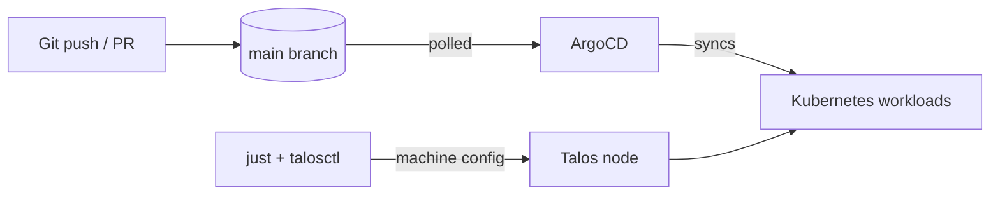

# zion

GitOps-managed [Talos Linux](https://www.talos.dev) Kubernetes homelab.
Every node has its own specific patch for node-related settings,
while everything else is shared.

## Stack

| Layer | Tool |
| --- | --- |
| Operating system | Talos Linux, image built with Image Factory (system extensions pinned in `talos/schematic.yaml`) |
| OS configuration | `talosctl` driven by `just`, patches layered per cluster/role/node |
| GitOps | ArgoCD (self-managed, app-of-apps) |
| Storage | Longhorn |
| Remote access | Tailscale |
| Secrets | SOPS + age for Talos secrets; secrets are never committed |
| Tooling | `mise` pins every CLI, `just` is the task runner |

Versions are pinned in `talos/cluster.yaml`, `mise.toml` and
the ArgoCD `Application` manifests.
What is currently deployed is defined in `kubernetes/applications/`.

## How it works



Two independent layers:

- **Operating system** (`talos/`): `just build` renders one
machine config per node from `talos/cluster.yaml`
plus patches in `all/`, `controlplane/`, `worker/`
and `nodes/<name>/`. `just diff <node>` shows what
would change, `just apply <node>` applies it.
- **Kubernetes** (`kubernetes/`): ArgoCD watches `main`. The `root`
Application syncs every `Application`
in `kubernetes/applications/`; each one points to a
Helm chart or to manifests under `infrastructure/` and `workloads/`.

## Repository Layout

```
talos/
  cluster.yaml              # cluster definition: name, endpoint, versions, nodes 
  cluster.schema.json       # JSON Schema validating cluster.yaml
  schematic.yaml            # Talos system extensions
  all/ controlplane/ worker/ nodes/<name>/ # machine config patches
kubernetes/
  root.yaml                 # app-of-apps entry point, applied once by `just bootstrap`
  applications/             # ArgoCD Application objects
  infrastructure/           # manifests for cluster components (ArgoCD itself)
  workloads/                # manifests for user-facing apps
docs/                       # architecture, decisions, disaster recovery
justfile                    # task runner recipes
mise.toml                   # pinned tool versions
```

## Common tasks

```sh
mise install                # install the pinned tools 
just --list                 # all recipes 
just check                  # validate talos/cluster.yaml
just schematic              # register talos/schematic.yaml with Image Factory, update the installer image
just kubeconfig <node>      # fetch the kubeconfig
just diff <node>            # preview an OS config change 
just apply <node>           # apply it, no reboot 
just upgrade <node>         # upgrade talos to the image in talos/all/installer.yaml
just health                 # cluster health
just bootstrap              # install ArgoCD on a fresh cluster
```

## Security model

- The repository is public, so nothing secret is committed: the
Talos secrets bundle, generated config and kubeconfig
files are git-ignored, Kubernetes Secrets are created out of band.
- A pre-commit hook runs [gitleaks](https://github.com/gitleaks/gitleaks);
`main` is protected (pull request required, no force push) and GitHub secret scanning is on.
- Services are exposed only through Tailscale, never to the public internet.

See [docs/disaster-recovery.md](docs/disaster-recovery.md) to rebuild the cluster.
